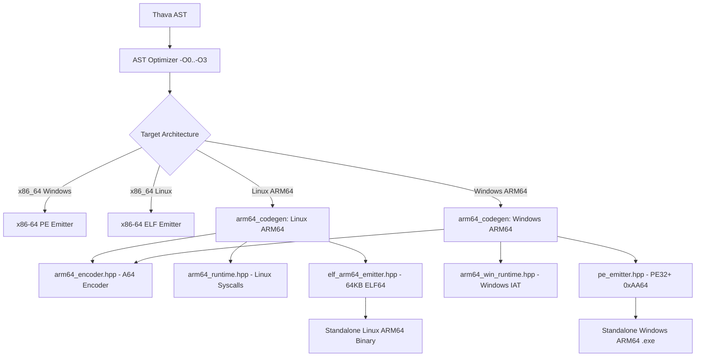

# Thava Programming Language: Official Reference Manual

Welcome to the official language specification and technical documentation for **Thava** (`thavac`).

---

## Table of Contents

1. [Language Overview & Design Principles](#1-language-overview--design-principles)
2. [Source Code Representation & Lexical Structure](#2-source-code-representation--lexical-structure)
3. [Type System](#3-type-system)
   - [Primitive Types](#primitive-types)
   - [Collection Types](#collection-types)
   - [First-Class Function Type (`<func>`)](#first-class-function-type-func)
   - [Special Types](#special-types)
   - [Type Casting](#type-casting)
4. [Expressions & Operators](#4-expressions--operators)
   - [Arithmetic Operators](#arithmetic-operators)
   - [Bitwise Operators](#bitwise-operators)
   - [Logical & Comparison Operators](#logical--comparison-operators)
   - [Ternary Conditional Expression](#ternary-conditional-expression)
   - [String Manipulation & Interpolation](#string-manipulation--interpolation)
5. [Statements & Control Flow](#5-statements--control-flow)
   - [Variable Declarations & Assignments](#variable-declarations--assignments)
   - [Constants](#constants)
   - [Global Variables](#global-variables)
   - [Branching (`if`, `elif`, `else`)](#branching-if-elif-else)
   - [Loops (`for`, `range`, `while`)](#loops-for-range-while)
   - [Jump Statements (`break`, `continue`)](#jump-statements-break-continue)
   - [Scoped Context Blocks (`file.open`)](#scoped-context-blocks-fileopen)
   - [Error Raising & Exception Handling (`raise_error`, `throw`, `try`, `except`)](#error-raising--exception-handling-raise_error-throw-try-except)
   - [Deferred Cleanup (`defer`)](#deferred-cleanup-defer)
6. [Functions & Code Generation](#6-functions--code-generation)
   - [Function Declarations & Return Syntax](#function-declarations--return-syntax)
   - [Default Arguments](#default-arguments)
   - [Mutual Recursion & Forward Declarations (`fdfunc`)](#mutual-recursion--forward-declarations-fdfunc)
   - [Inline Functions (`inline func`)](#inline-functions-inline-func)
   - [Function Pointers & Callbacks](#function-pointers--callbacks)
7. [Object-Oriented Programming (OOP) & Structs](#7-object-oriented-programming-oop--structs)
   - [Classes & Single Inheritance](#classes--single-inheritance)
   - [Access Modifiers](#access-modifiers)
   - [Constructors, `locvar`, and `parvar`](#constructors-locvar-and-parvar)
   - [Native Structs](#native-structs)
   - [Enumerations (`enum`)](#enumerations-enum)
8. [Compiler Directives & Foreign Function Interface (FFI)](#8-compiler-directives--foreign-function-interface-ffi)
   - [Modular Inclusions (`@attach`)](#modular-inclusions-attach)
   - [Dynamic Library Linkage (`@dlattach`)](#dynamic-library-linkage-dlattach)
   - [C/C++ Interoperability (`@cattach`, `cfunc`, `c.`)](#cc-interoperability-cattach-cfunc-c)
9. [Standard Libraries Reference](#9-standard-libraries-reference)
   - [`cons` (Console I/O)](#cons-console-io)
   - [`key` (Keyboard Input)](#key-keyboard-input)
   - [`os` (Operating System Services)](#os-operating-system-services)
   - [`time` (Clocks & Dates)](#time-clocks--dates)
   - [`clib` (Dynamic Library Interop & Raw Memory FFI)](#clib-dynamic-library-interop--raw-memory-ffi)
10. [Built-in Collection & String API](#10-built-in-collection--string-api)
    - [String Manipulation (`<str>`)](#string-manipulation-str)
    - [List Operations (`<lst>`)](#list-operations-lst)
    - [Dictionary Operations (`<dict>`)](#dictionary-operations-dict)
11. [File I/O & Scoped Streams (`file.open`)](#11-file-io--scoped-streams-fileopen)
12. [Compiler Architecture & Optimization Pipeline](#12-compiler-architecture--optimization-pipeline)
    - [Compiler Invocation & Flags](#compiler-invocation--flags)
    - [Optimization Levels (`-O0` to `-O3`)](#optimization-levels--o0-to--o3)
    - [Embedded Binary Metadata Format](#embedded-binary-metadata-format)
13. [Target Platforms & ARM64 Architecture](#13-target-platforms--arm64-architecture)
    - [Supported Target Platforms](#supported-target-platforms)
    - [32-bit x86 (i686)](#32-bit-x86-i686)
    - [AArch64 / ARM64 Backend Architecture](#aarch64--arm64-backend-architecture)

---

## 1. Language Overview & Design Principles

**Thava** is a statically typed, compiled systems and application programming language designed to unite the performance and raw memory capabilities of C with the syntactic clarity and rapid development velocity of modern high-level languages.

### Core Architectural Pillars
1. **Self-Contained Direct Code Generation:**
   `thavac` emits machine code for x86-64, ARM64, and i686 directly to Windows PE32/PE32+ or Linux ELF32/ELF64. Native builds require no external linker or assembler. Windows targets use system DLLs, while standalone Linux targets call the kernel directly.
2. **Dual-Backend Resilience:**
   While the direct native backend produces zero-dependency machine code with microsecond build times, Thava also features a transpiler targeting standard C++17. This fallback automatically activates when interfacing with native C++ headers via `@cattach`.
3. **Determinism and Zero-Cost Abstractions:**
   Memory safety is achieved through deterministic scoping rules, RAII context guards (`file.open`), and stack-allocated `defer` tracking rather than garbage collection pause times.

---

## 2. Source Code Representation & Lexical Structure

### Encodings & Files
* Thava source files must be encoded in **UTF-8**.
* Source files use the `.thv` extension.
* Compiled Thava dynamic libraries on Windows use `.thdl` (Thava Dynamic Library) and on Linux use `.so`.

### Comments
```thava
# This is a single-line comment (Python-style)
// This is also a single-line comment (C-style)
/* This is a multi-line comment block */
```

### Identifiers
Identifiers start with an ASCII letter or underscore (`[a-zA-Z_]`) followed by alphanumeric characters or underscores (`[a-zA-Z0-9_]`). Identifiers are case-sensitive (`data` and `Data` are distinct symbols).

---

## 3. Type System

Thava employs explicit, static typing with a clean angle-bracket syntax `<type>` that clearly differentiates type annotations from variable identifiers.

### Primitive Types
| Type | Keyword | Size | Description |
| :--- | :--- | :--- | :--- |
| **Integer** | `<int>` | 64-bit | Signed two's-complement integer (`long long`). |
| **Float** | `<fl>` | 32-bit | Single-precision IEEE 754 floating-point. |
| **Double** | `<dbl>` | 64-bit | Double-precision IEEE 754 floating-point. |
| **Boolean** | `<bl>` | 8-bit / 1-bit | Logical truth value (`true` or `false`). |
| **String** | `<str>` | Dynamic | Heap-allocated UTF-8 character string. |

### Collection Types
| Type | Keyword | Description |
| :--- | :--- | :--- |
| **List** | `<lst>` | Dynamic array of heterogeneous `ThavaValue` elements (`[1, "two", 3.0]`). |
| **Tuple** | `<tple>` | Fixed-size immutable sequence (`(10, 20, "label")`). |
| **Dictionary** | `<dict>` | Associative key-value map (`{"id": 101, "role": "admin"}`). |
| **Multi-Type** | `<multype>` | Generic variant container holding any supported primitive or collection. |

### First-Class Function Type (`<func>`)
Thava treats functions as first-class citizens without the cryptic syntax of C function pointers. The `<func>` type (aliases: `<fn>`, `<callback>`) stores references to functions with arbitrary signatures:
```thava
<int> func multiply(<int> a, <int> b) {
    return a * b
}

# Variable declaration
<func> operation = multiply

# Invocation
<int> result = operation(7, 8) # 56
```

### Special Types
* `<void>`: Indicates that a function returns no value.
* `none`: Represents the absence of a value (`ThavaNoneType`). Equivalent to `None` in Python or `nullptr`.

### Type Casting
Thava provides explicit type casting using either `<target_type>(expr)` or `<target_type> expr`:
```thava
<dbl> precise = 9.99
<int> truncated = <int>(precise) # 9

<int> number = 42
<str> as_string = <str>(number) # "42"
```

Casting a `<dbl>` to `<str>` formats the numeric value as text. The examples below show rounding and the removal of trailing zeros.

```thava
cons.out(<str>(1.0 / 3.0))   # 0.333333
cons.out(<str>(2.0 * 3.5))   # 7
```

---

## 4. Expressions & Operators

### Arithmetic Operators
* `+` : Addition or string concatenation.
* `-` : Subtraction or unary negation.
* `*` : Multiplication, or string repetition (`"abc" * 3` -> `"abcabcabc"`).
* `/` : Floating-point division.
* `//` : Floor (integer) division.
* `%` : Modulo / remainder.
* `**` : Exponentiation (`2 ** 10` -> `1024`).

### Bitwise Operators
* `band` : Bitwise AND (`a band b`).
* `bor`  : Bitwise OR (`a bor b`).
* `bxor` : Bitwise XOR (`a bxor b`).
* `bnot` : Bitwise NOT (`bnot a`).
* `<<`   : Bitwise shift left (`x << 2`).
* `>>`   : Bitwise shift right (`x >> 2`).
* `bshl` : Keyword alias of `<<` (`a bshl b`).
* `bshr` : Keyword alias of `>>` (`a bshr b`).

### Logical & Comparison Operators
* `and`, `or`, `not` : Boolean logical conjunction, disjunction, and negation.
* `==`, `!=` : Equality and inequality (supports deep equality for collections).
* `<`, `<=`, `>`, `>=` : Relational comparisons.
* `in` : Collection membership test (`if 3 in [1, 2, 3] { ... }`).

### Ternary Conditional Expression
Thava supports Pythonic inline conditional expressions:
```thava
<str> status = "adult" if age >= 18 else "minor"
```

### String Manipulation & Interpolation
Strings support UTF-8-safe methods and string interpolation inside `cons.out`:
```thava
<str> s = "  hello world  "
cons.out(s.strip().title()) # "Hello World" (Method chaining supported)

# String Interpolation using @{...}
<int> score = 95
cons.out("Player score is: @{score} points (@{score + 5} next level)")
```

---

## 5. Statements & Control Flow

### Variable Declarations & Assignments
```thava
<int> x = 100
x += 25
x *= 2
```
Compound assignment also works on strings, where `+=` concatenates:
```thava
<str> greeting = "Hello"
greeting += ", "
greeting += name      # "Hello, <name>"
```
`+=` on an `<int>`/`<dbl>` accepts a list element (`total += xs[i]`) on every backend, including `--cpp`. Operators that have no meaning on strings (`-=`, `/=`, `%=`) are rejected at compile time.

#### Constants

Place `const` between the type and the name. A const variable requires an initializer, which can be a runtime expression. The compiler rejects reassignment, compound assignment, and direct writes such as changing a list element through its const name. A const global can be read from functions without a `global` declaration. Objects and collections may still be changed through a shared mutable reference.

```thava
<int> const a = 10
<fl> const b = 2.4
<dbl> const so_thuc = 12
```

#### Function-Level Scoping
Blocks do **not** open a new scope: a variable declared inside `if`, `while` or `for` lives until the end of the enclosing function (or until the end of the program at top level).
```thava
func scan() {
    for <int> i in range(0, 3) {
        <int> last = i
    }
    cons.out(last) # Legal: 2
}
```

### Global Variables
A variable declared at the top level of the program is a **global**. Globals are visible from every function, method and constructor:
```thava
<int> counter = 0
<lst> names = ["ada", "alan"]

<int> func size() -> <int> {
    return names.len()   # reading a global: supported
}

class Report {
    <int> rows;
    func Report() {
        locvar.rows = size()
    }
    <int> func total() {
        return counter + locvar.rows   # reading a global from a method
    }
}
```

Functions can read globals, index global collections, and pass them as arguments on native x86-64, ARM64, and i686, as well as through the C++ transpiler.

To write a global inside a function, method or constructor, declare it in that body before the first write. The type must match the top-level declaration, including integer width. Reading a global needs no declaration. A parameter or local variable with the same name cannot also be declared global in that body.

```thava
<int> counter = 2
<lst> names = ["ada"]
func update() {
    global <int> counter
    global <lst> names
    counter **= 2
    names[0] = "alan"
    names.addval("grace")
}
update()
cons.out("@{counter} @{names[0]}")  # 4 alan
```

The declaration also permits mutation of a global dictionary on backends with dictionary support. For example, after `global <dict> scores`, both `scores["k"] = 1` and `scores.del("k")` update the top-level dictionary. Each called function that writes a global needs its own declaration. Integer globals support `+=`, `-=`, `*=`, `/=`, `%=` and `**=`. Floating-point globals support arithmetic compound assignments except `%=`. Strings support assignment and `+=`. For native global lists, use indexed assignment to replace an element and single-argument `addval(value)` to append.

Top-level code may of course assign globals freely, and a local variable or parameter that shadows a global is assignable as usual:
```thava
<int> total = 0
total = 5              # legal: top-level assignment

func work(<int> total) {
    total += 1         # legal: the parameter shadows the global
}
```

### Branching (`if`, `elif`, `else`)
Braces `{}` are mandatory; parentheses around conditions are optional.
```thava
if x > 200 {
    cons.out("Greater than 200")
} elif x == 200 {
    cons.out("Equal to 200")
} else {
    cons.out("Less than 200")
}
```

### Loops (`for`, `range`, `while`)
Thava provides three primary loop constructs:

#### 1. Python-style Range Loop
The step direction (positive or negative) is evaluated dynamically at runtime:
```thava
for <int> i in range(0, 10, 2) {
    cons.out(i) # Prints 0, 2, 4, 6, 8
}
```

#### 2. Foreach Iteration
Iterates over elements in lists, tuples, dictionaries (keys), or strings:
```thava
for <str> item in ["apple", "banana", "cherry"] {
    cons.out(item)
}
```

#### 3. Classic C-style 3-part Loop
```thava
for <int> i = 0, i < 5, i += 1 {
    cons.out(i)
}
```

#### 4. While Loop
```thava
while active {
    # do work
}
```

### Jump Statements (`break`, `continue`)
Supported inside all loop constructs:
```thava
for <int> i in range(1, 100) {
    if i % 2 == 0 { continue }
    if i > 15 { break }
    cons.out(i)
}
```

### Scoped Context Blocks (`file.open`)
Guarantees that files are closed deterministically upon exiting the scope:
```thava
file.open("config.json", "r") as f {
    <str> content = f.read()
    cons.out(content)
} # Closed automatically
```

### Error Raising & Exception Handling (`raise_error`, `throw`, `try`, `except`)

Thava features a dual-layer error management system supporting both **compile-time semantic assertion failures** and **runtime exception handling**.

#### 1. Raising Explicit Errors (`raise_error`)

The `raise_error` construct allows developers to trigger fatal errors either statically during compilation or dynamically during program execution:

```
raise_error(kind, type, message)
```

* **`kind` (Evaluation Mode):**
  * `c` or `compile`: **Compile-Time Error**. Evaluated during the compiler's semantic analysis and static type-checking pass. If reached or evaluated in static code, `thavac` immediately halts compilation with exit code `1` and outputs:
    ```text
    [Compilation Error (type)]: message at line <line_number>
    ```
    This is ideal for static assertion guards, architecture verification, and configuration invariants.
  * `r` or `runtime`: **Runtime Error**. Evaluated at runtime when execution reaches the statement. Both the Native Machine Code backend and the C++ transpiler emit an error message and terminate the process with exit code `1`:
    ```text
    [Runtime Error (type)]: message
    ```

* **`type` (Error Category):** String expression indicating the error type (e.g. `"ValueError"`, `"TypeError"`, `"IndexError"`, `"SecurityError"`).
* **`message` (Error Description):** String expression detailing the failure cause.

##### Code Examples:

```thava
# Example A: Compile-Time Assertion (kind: c)
# Halts thavac immediately during build time
func verify_environment() {
    # If a static rule or check fails:
    raise_error(c, "PlatformError", "Direct hardware access is not permitted on this architecture")
}

# Example B: Runtime Validation (kind: r)
# Halts application execution when triggered
<dbl> func calculate_square_root(<dbl> value) {
    if value < 0.0 {
        raise_error(r, "ValueError", "Cannot compute square root of a negative number")
    }
    # Calculation continues if value >= 0.0
    return c.sqrt(value)
}

func main() {
    <dbl> res = calculate_square_root(-4.0)
    # Output: [Runtime Error (ValueError)]: Cannot compute square root of a negative number
}
```

#### 2. Throwing Exceptions (`throw` / `raise`)

To throw an exception that can be caught by surrounding handler blocks, use `throw` or `raise`:

```thava
func process_file(<str> filepath) {
    if not os.exists(filepath) {
        throw "Target file was not found: " + filepath
    }
}
```

#### 3. Structured Exception Handling (`try`, `except`)

The `try`-`except` block intercepts thrown exceptions and runtime errors:

```thava
try {
    process_file("config.cfg")
} except RuntimeError as e {
    cons.out("Caught runtime error: @{e}")
} except {
    cons.out("Caught generic unhandled exception")
}
```

### Deferred Cleanup (`defer`)
Statements or blocks declared with `defer` execute right before the surrounding function returns or before the application exits in `main`.
* **LIFO (Last-In, First-Out):** Defers execute in reverse declaration order.
* **Return Value Safety:** Expressions returned by `return` are preserved in registers (`RAX`/`XMM0`) and cannot be corrupted by deferred statements.
```thava
<int> func execute_transaction() {
    cons.out("Start transaction")
    defer cons.out("Cleanup 1: End transaction")
    defer {
        cons.out("Cleanup 2: Flush WAL logs")
    }
    return 100
}
# Output:
# Start transaction
# Cleanup 2: Flush WAL logs
# Cleanup 1: End transaction
```

---

## 6. Functions & Code Generation

### Function Declarations & Return Syntax
Functions can specify return types preceding the name or after an arrow `->`:
```thava
# Standard declaration
<int> func compute(<int> a, <int> b) {
    return a + b
}

# Arrow return syntax
func compute_arrow(<int> a, <int> b) -> <int> {
    return a + b
}

# Void function (no return value)
<void> func log_event(<str> msg) {
    cons.out("[LOG]: " + msg)
}
```

### Default Arguments
Trailing parameters can specify default values:
```thava
<int> func power(<int> base, <int> exp = 2) {
    return base ** exp
}
cons.out(power(5))    # 25
cons.out(power(5, 3)) # 125
```

### Mutual Recursion & Forward Declarations (`fdfunc`)
When two or more functions call each other recursively, declare their signatures using `fdfunc`:
```thava
<bl> fdfunc is_even(<int> n)
<bl> fdfunc is_odd(<int> n)

<bl> func is_even(<int> n) {
    if n == 0 { return true }
    return is_odd(n - 1)
}

<bl> func is_odd(<int> n) {
    if n == 0 { return false }
    return is_even(n - 1)
}
```

### Inline Functions (`inline func`)
Prefixing a function with `inline` instructs the Thava AST Optimizer to eliminate function call overhead by copying and folding the function body directly into the call site:
```thava
inline <int> func fast_add(<int> a, <int> b) {
    return a + b
}

<int> sum = fast_add(10, 20) # Replaced with 10 + 20 -> 30 at compile-time!
```

### Function Pointers & Callbacks
Pass functions as arguments to implement event loops, filters, and strategy patterns:
```thava
<int> func filter_and_sum(<lst> items, <func> predicate) {
    <int> total = 0
    for <int> val in items {
        if predicate(val) {
            total += val
        }
    }
    return total
}

<bl> func is_positive(<int> x) {
    return x > 0
}

<int> result = filter_and_sum([-5, 10, -2, 20], is_positive) # 30
```

---

## 7. Object-Oriented Programming (OOP) & Structs

### Classes & Single Inheritance
Classes support single inheritance with encapsulation and polymorphism:

#### Constructors, `locvar`, and `parvar`

```thava
class Vehicle {
    <str> brand;
    <int> speed;

    func Vehicle(<str> brand, <int> speed) {
        locvar.brand = brand
        locvar.speed = speed
    }

    <void> func describe() {
        cons.out("Vehicle: " + locvar.brand + " @ " + <str>(locvar.speed) + " km/h")
    }
}

class Car : Vehicle {
    <int> doors;

    func Car(<str> brand, <int> speed, <int> doors) {
        parvar.init(brand, speed)
        locvar.doors = doors
    }

    <void> func describe() {
        cons.out("Car: " + locvar.brand + " (" + <str>(locvar.doors) + " doors)")
    }
}
```

### Access Modifiers
* `public`: Accessible from anywhere (default).
* `protected`: Accessible within the declaring class and derived subclasses.
* `private`: Accessible strictly within the declaring class.

### Native Structs
Structs represent lightweight, contiguous memory layouts:
```thava
struct Vector3 {
    <dbl> x;
    <dbl> y;
    <dbl> z;
}

Vector3 v = Vector3(1.0, 2.5, 0.0)
v.z = 10.0
```

### Enumerations (`enum`)
```thava
enum HttpStatus {
    OK = 200,
    NOT_FOUND = 404,
    SERVER_ERROR = 500
}

<int> code = HttpStatus.NOT_FOUND
```

---

## 8. Compiler Directives & Foreign Function Interface (FFI)

### Modular Inclusions (`@attach`)
Thava provides safe module attachment. Circular inclusions are guarded automatically:
```thava
@attach <math_utils.thv>
@attach "engine/renderer.thv"
```

### Dynamic Library Linkage (`@dlattach`)
When loading a Thava dynamic library (`.thdl` or `.so`), the compiler reads embedded export metadata directly from the binary:
```thava
@dlattach <math_lib.thdl>
# Functions declared in math_lib are now available with full static typing!
```

Import resolution depends on the target:

- **Windows PE x86-64** loads the `.thdl`/`.dll` at run time through the Windows loader (IAT thunks), exactly like before.
- **Windows PE ARM64** builds an ARM64 `.thdl` as a DLL with a PE export table. The consumer imports the functions by name and calls each module's initializer once before running its own top-level code. The module's global values persist across calls. Place the DLLs, including transitive dependencies, beside the executable. Rebuild any ARM64 `.thdl` from before this support with `thavac library.thv --target win-arm64 --lib -o library.thdl`. Native ARM64 calls pass arguments beyond the first eight on the stack, including collection references.
- **Native i686** uses PE32 DLLs on Windows and position-independent ELF32 modules on Linux. Build both sides with the same i686 target and `--native`. Include matching class and struct declarations with `@attach` when a signature shares those types across the module boundary.
- **`--backend cpp`** keeps its dynamic linking through the host compiler.
- **Native Linux ELF64 (x86-64 and AArch64)** are zero-libc, so the generated program carries its own loader: at start-up it maps the `.so` with `mmap`, applies the module's relocations, runs its top-level initializer once, and calls the exports through the mapped image. The library is **not** inlined, so — exactly like on Windows — the `.so` has to exist at run time; the executable itself stays a single self-contained file. The `.so` is located by its absolute path at compile time, so the directory you run the executable from does not matter.

The Linux ELF64 loaders first open the absolute path recorded at compile time. If that fails, they retry the library by file name in the current working directory.

The native Linux ELF64 loaders reserve a separate address window for each attached library. Attaching the same library twice is de-duplicated. If a library cannot be mapped the program prints
```
[Thava Runtime] cannot load library '/path/to/thava_math.so'
```
and exits with status 1. The library must have been produced by a compiler that writes export offsets (`--lib`), because the loader enters an export at `load base + .text offset + function offset`:
```
error: dynamic library 'lib/thava_math.so' exports no offsets; rebuild it with --lib using this compiler.
```
A library built for another architecture is rejected at compile time, so a stray `thava_math.so` for the wrong target cannot be loaded by accident:
```
error: dynamic library 'thava_math.so' was built for 'x86-64-elf', but this target is 'arm64-elf'.
```
The same mechanism handles `@attach <lib.thdl>` / `@attach <lib.so>` on those targets.

### C/C++ Interoperability (`@cattach`, `cfunc`, `c.`)
To call external C libraries or C++ headers, attach the header and declare signatures with `cfunc`:
```thava
@cattach <math.h>

<dbl> cfunc sin(<dbl> rad)
<dbl> cfunc cos(<dbl> rad)

<dbl> val = c.sin(1.57) # Explicit C namespace invocation
```
The `c.` namespace is only assumed when the program does **not** declare its own variable named `c`. If it does, `c.field` and `c.method(...)` are ordinary member access, so a variable called `c` behaves like any other:
```thava
<Car> c = Car()
cons.out("speed = @{c.speed}")
c.drive(10)
```

---

## 9. Standard Libraries Reference

Thava comes equipped with built-in standard modules that provide essential runtime and operating system capabilities.

### `cons` (Console I/O)
* `cons.out(expr)`: Writes exactly one expression to standard output, followed by a newline. To combine text and values, use one string literal with interpolation (`@{expression}`) — `cons.out` takes a single argument, not a comma-separated list.
* `cons.clear()`: Clears the terminal screen and moves the cursor to the top-left corner (ANSI `ESC[2J ESC[H`). Takes no arguments and is only valid as a statement.

```thava
<str> name = "World"
<int> count = 42
cons.out("Hello @{name}, count: @{count}")
cons.out("Interpolated: @{name} has @{count * 2} items")
```

### `key` (Keyboard Input)
* `key.input(<type>, prompt)`: Displays `prompt` to standard output and reads input from standard input, parsing it into the requested type `<int>`, `<fl>`, `<dbl>`, `<bl>`, or `<str>`.
* `key.input.upper(<str>, prompt)`: Reads a line of input and converts all characters to uppercase.
* `key.input.lower(<str>, prompt)`: Reads a line of input and converts all characters to lowercase.
* `key.input.title(<str>, prompt)` reads a line of input and applies the same Unicode titlecase mapping as `.title()`.

```thava
<int> age = key.input(<int>, "Enter your age: ")
<str> command = key.input.lower(<str>, "Action [run/stop]: ")
```

### `os` (Operating System Services)
Provides high-performance platform utilities:
* `os.system(<str> cmd) -> <int>`: Executes a command string in the host system shell and returns the exit status code.
* `os.getcwd() -> <str>`: Returns the current working directory path.
* `os.chdir(<str> path) -> <bl>`: Changes the current working directory.
* `os.exists(<str> path) -> <bl>`: Returns `true` if a file or directory exists at `path`.
* `os.is_file(<str> path) -> <bl>`: Returns `true` if `path` is a regular file.
* `os.is_dir(<str> path) -> <bl>`: Returns `true` if `path` is a directory.
* `os.getsize(<str> path) -> <int>`: Returns file size in bytes (-1 on failure).
* `os.listdir(<str> path) -> <lst>`: Returns a list of filenames contained in directory `path`.
* `os.mkdir(<str> path) -> <bl>`: Creates a directory.
* `os.rmdir(<str> path) -> <bl>`: Removes an empty directory.
* `os.remove(<str> path) -> <bl>`: Deletes a file from the filesystem.
* `os.rename(<str> old_path, <str> new_path) -> <bl>`: Renames or moves a file.
* `os.getenv(<str> var_name) -> <str>`: Retrieves the value of an environment variable.
* `os.setenv(<str> var_name, <str> val) -> <bl>`: Sets or updates an environment variable.
* `os.getpid() -> <int>`: Returns the unique process ID of the current running process.
* `os.cpu_count() -> <int>`: Returns the number of logical CPU cores available.
* `os.sleep(<int> milliseconds)`: Suspends execution for the specified time interval.
* `os.showmessagebox(<int> icon, <str> title, <str> content, <int> buttons)`: Displays a native operating system message dialog.

### `time` (Clocks & Dates)
* `time.timestamp() -> <int>`: Returns the current Unix epoch time in seconds.
* `time.millis() -> <int>`: Returns high-resolution epoch time in milliseconds.
* `time.now(<str> format) -> <str>`: Returns the current time formatted according to the specifier string (e.g., `"YYYY-MM-DD HH:mm:ss"`).
* `time.date() -> <str>`: Returns date in standard `"YYYY-MM-DD"` format.
* `time.year() -> <int>`: Current 4-digit calendar year (e.g. `2026`).
* `time.month() -> <int>`: Current month (`1` - `12`).
* `time.day() -> <int>`: Current day of month (`1` - `31`).
* `time.hour() -> <int>`: Current hour in 24-hour format (`0` - `23`).
* `time.minute() -> <int>`: Current minute (`0` - `59`).
* `time.second() -> <int>`: Current second (`0` - `59`).

### `clib` (Dynamic Library Interop & Raw Memory FFI)
Where supported, `clib` loads shared libraries (`.dll` on Windows, `.so` on Linux) and reads or writes memory in the current process. For i686, use the C++ backend for C interop. Store library handles and pointers in `<int64>` on 64-bit targets.

* `clib.load(<str> path) -> <int>`: Loads a dynamic shared library into the address space and returns an opaque library handle.
* `clib.free(<int> handle) -> <bl>`: Unloads the library from memory.
* `clib.has(<int> handle, <str> symbol) -> <bl>`: Checks if an exported function symbol exists in the library.
* `clib.call(<int> handle, <str> symbol, args...) -> <int>`: Calls an exported C-ABI function returning a 64-bit integer.
* `clib.call_dbl(<int> handle, <str> symbol, args...) -> <dbl>`: Calls an exported function returning a 64-bit double precision float.
* `clib.call_str(<int> handle, <str> symbol, args...) -> <str>`: Calls an exported function returning a null-terminated `const char*`.
* `clib.alloc(<int> bytes) -> <int>`: Allocates a contiguous heap block and returns its 64-bit memory pointer.
* `clib.free_mem(<int> ptr) -> <void>`: Deallocates a heap block allocated via `clib.alloc`.
* `clib.peek_u8(<int> ptr, <int> offset) -> <int>`: Reads an 8-bit unsigned byte.
* `clib.peek32(<int> ptr, <int> offset) -> <int>`: Reads a 32-bit signed integer.
* `clib.peek64(<int> ptr, <int> offset) -> <int>`: Reads a 64-bit signed integer.
* `clib.peek_f(<int> ptr, <int> offset) -> <dbl>`: Reads a 64-bit floating-point number.
* `clib.poke32(<int> ptr, <int> offset, <int> val) -> <void>`: Writes a 32-bit integer into memory.
* `clib.poke64(<int> ptr, <int> offset, <int> val) -> <void>`: Writes a 64-bit integer into memory.
* `clib.poke_f(<int> ptr, <int> offset, <dbl> val) -> <void>`: Writes a 64-bit float into memory.

---

## 10. Built-in Collection & String API

Thava variables of string and collection types feature built-in methods with seamless dot-notation syntax:

### String Manipulation (`<str>`)
* `s.len() -> <int>` returns the UTF-8 byte count.
* `s.upper() -> <str>`: Returns an uppercase copy.
* `s.lower() -> <str>`: Returns a lowercase copy.
* `s.strip() -> <str>`: Trims leading and trailing whitespace.
* `s.title() -> <str>`: Applies titlecase to the first character of each whitespace-delimited word and lowercase to the rest.

The three case methods and their `key.input` counterparts use Unicode 17.0 UTF-8 case mappings. Mappings can expand a character, such as `ß` to `SS` in uppercase. Thava applies unconditional case mappings without Unicode normalization or locale-specific rules.

* `s.find(<str> substr) -> <int>`: Returns the 0-based index of the first occurrence of `substr` (-1 if not found).
* `s.count(<str> substr) -> <int>`: Counts non-overlapping occurrences of `substr`.
* `s.replace(<str> old_str, <str> new_str) -> <str>`: Replaces all occurrences of `old_str` with `new_str`.
* `s.split(<str> delimiter) -> <lst>`: Splits string into a list of substrings.
* `s.startswith(<str> prefix) -> <bl>`: Returns `true` if string starts with `prefix`.
* `s.endswith(<str> suffix) -> <bl>`: Returns `true` if string ends with `suffix`.
* `s.getsubstring(<int> start, <int> end) -> <str>` uses one-based, inclusive UTF-8 code point positions.

### List Operations (`<lst>`)
* `lst.len() -> <int>`: Returns element count.
* `lst.append(<multype> val)` / `lst.addval(<multype> val)`: Appends an item to the end of the list.
* `lst.insert(<int> index, <multype> val)`: Inserts an item at the specified position.
* `lst.remove(<multype> val)` / `lst.removeval(<multype> val)`: Removes the first occurrence of `val`.
* `lst.pop(<int> index = -1) -> <multype>`: Removes and returns the item at `index` (defaults to last element).
* `lst.index(<multype> val) -> <int>`: Returns index of first match (-1 if absent).
* `lst.count(<multype> val) -> <int>`: Counts occurrences of `val`.
* `lst.clear()`: Empties the list.

**Element typing and indexed access.** For homogeneous lists, the compiler can infer the element type from the declaration (`<lst> xs = [1, 2]` → `<int>`, `[1.5, 2.5]` → `<dbl>`, `["a"]` → `<str>`). The inferred type also helps the compiler handle indexed access when lists are passed to functions or methods:
```thava
<lst> rates = [1.5, 2.5, 3.5]
<dbl> func rate(<int> i) -> <dbl> {
    return rates[i]   # 2.5 for i = 1
}
```
A `<lst>`/`<tple>` **parameter** has no declared element type, so it takes the element type of the lists the function, method or constructor is called with. That is what makes `param[i]`, comparisons such as `param[i] > param[j]` and stores such as `param[i] = value` behave like they do at the call site:
```thava
func heapify(<lst> arr, <int> n, <int> i) {
    if arr[i] > arr[0] {
        <dbl> swap = arr[i]
        arr[i] = arr[0]
        arr[0] = swap
    }
}

<lst> data = [12.0, -1.5, 9.8]
heapify(data, 3, 2)   # inside heapify, arr[i] is <dbl>
```
Several call sites may pass different lists; the types are merged like list literals merge them — a `<dbl>` list anywhere makes the parameter `<dbl>`, `<str>` wins over `<int>`, otherwise it is `<int>`. A parameter that is never called keeps the old default (`<int>`) so existing programs compile unchanged.
Indexing a bare literal (`[1.5, 2.5][1]`) works too: the element type is taken from the literal itself, so it behaves the same on every backend.

### Dictionary Operations (`<dict>`)
* `d.len() -> <int>`: Returns number of key-value pairs.
* `d.keys() -> <lst>`: Returns a list containing all keys.
* `d.values() -> <lst>`: Returns a list containing all values.
* `d.items() -> <lst>`: Returns a list of key-value tuples.
* `d.get(<str> key, <multype> default_val = none) -> <multype>`: Retrieves value or returns default.
* `d.contains(<str> key) -> <bl>`: Checks if `key` exists in dictionary.
* `d.del(<str> key)`: Deletes key and its associated value.
* `d.clear()`: Empties all entries from the dictionary.

---

## 11. File I/O & Scoped Streams (`file.open`)

Thava handles file input/output through RAII-guarded context blocks (`file.open ... as <handle>`). The stream automatically flushes buffers and closes upon exiting the block, even if an unhandled exception or early `return` occurs inside:

### Supported Open Modes
| Mode | Description |
| :--- | :--- |
| `"r"` | Read text (default). File must exist. |
| `"w"` | Write text. Overwrites existing file or creates new file. |
| `"a"` | Append text. Writes to the end of the file. |
| `"rb"` | Read binary stream. |
| `"wb"` | Write binary stream. |

### Stream Methods
* `f.read() -> <str>`: Reads the entire file content into a string.
* `f.readline() -> <str>` / `f.read_line()` returns a single line with the line ending removed.
* `f.readlines() -> <lst>` / `f.read_lines()`: Reads all lines and returns a list of strings.
* `f.write(<str> text)`: Writes string to the stream.
* `f.writeline(<str> text)` / `f.write_line(<str> text)` writes a string followed by a newline.

```thava
# Writing to a file
file.open("output.txt", "w") as f {
    f.writeline("Thava File I/O Engine")
    f.writeline("Deterministic Scoping Demonstration")
}

# Reading lines from a file
file.open("output.txt", "r") as f {
    for <str> line in f.readlines() {
        cons.out("Read line: " + line.strip())
    }
} # Stream is closed deterministically here
```

---

## 12. Compiler Architecture & Optimization Pipeline

### Compiler Invocation & Flags
```text
Usage: thavac <source.thv> [--target <target>] [--native|--cpp] [-o <output>] [--lib] [-O0|-O1|-O2|-O3]
       thavac --info <file.thdl|.so>
```

| Flag | Description |
| :--- | :--- |
| `-o <filename>` | Specify output executable or dynamic library name. |
| `--arch x86_64`, `--arch arm64`, `--arch i686` | Select an architecture. Use `--target` to specify both the operating system and architecture. |
| `--native` / `--backend native` | Select direct machine code generation. Without a target, the default is native x86-64 for the compiler host OS. |
| `--target win-x64` / `--target linux-x64` | Target Windows or Linux x86-64. |
| `--target win-arm64` / `--target linux-arm64` | Target Windows or Linux ARM64. |
| `--backend arm64` / `--backend elf-arm64` | Direct Native Linux AArch64 (ARM64) ELF64 code generation. |
| `--backend pe-arm64` | Select the native Windows ARM64 emitter (PE32+). |
| `--target win-i686` / `--target linux-i686` | Target Windows or Linux i686. These targets use the C++ toolchain by default. Add `--native` for direct code generation. |
| `--backend pe-i686` / `--backend elf-i686` | Select native Windows PE32 or Linux ELF32 directly. |
| `--backend elf` | Direct Native Linux x86-64 ELF64 binary. |
| `--backend pe` | Direct Native Windows x86-64 PE32+ binary. |
| `--cpp` / `--backend cpp` | Transpile to C++17 and build with a C++ toolchain for the target. |
| `--cxx <compiler>` | Select the C++ compiler. `CXX` can also set this value. |
| `--lib` | Build as a Dynamic Library (`.thdl` on Windows, `.so` on Linux). |
| `-O0` to `-O3` | AST Optimization levels (Dead Code Elimination, Inlining, Constant Folding). |
| `--info <file>` | Inspect embedded metadata of a Thava Dynamic Library (`.thdl` / `.so`). |

### Optimization Levels (`-O0` to `-O3`)
* **`-O0`** skips AST optimization.
* **`-O1`** folds literal expressions, eliminates branches with constant conditions, and expands eligible `inline func` declarations. Native backends can also apply instruction-level optimizations.
* **`-O2`** adds constant propagation for ordinary `<int>` and `<bl>` locals in straight-line function code. For example, after `<int> base = 40`, it folds `return base + 2` into `return 42`. A call or control-flow boundary ends the region where those values are tracked.
* **`-O3`** also tries to inline eligible leaf functions automatically.

### Embedded Binary Metadata Format
When generating dynamic libraries (`--lib`), `thavac` embeds an internal metadata section bounded by `__THAVA_METADATA_START__` and `__THAVA_METADATA_END__`. `@dlattach` reads export signatures from this section. Native i686 code that shares typed class or struct values also includes their declarations with `@attach`.

Besides one `func:<name>|ret:<type>|params:<...>` line per export, the section carries what the zero-libc loaders need to enter the module:

* `machine:<id>` identifies the target and, where applicable, the module ABI. Examples include `x86-64-elf`, `arm64-elf`, `x86-64-pe`, `arm64-pe`, `i686-pe-v2`, and `i686-elf-v2`. The compiler rejects libraries built for a different target.
* `image:0x...` — the base address the library was linked for (`0x400000`).
* `text:0x...` — image offset of the library's `.text`.
* `data:0x...` — image offset of its data section.
* `init:0x...` — offset of the module initializer (its top-level statements), if the library has any.
* `|off:0x...` on a `func:` line — offset of that export inside `.text`.
* `reloc:0x...,0x...` records relocation offsets for native ELF64 modules. Each entry identifies an 8-byte absolute word the loader must adjust.

---

## 13. Target Platforms & ARM64 Architecture

### Supported Target Platforms

| Native target | Binary format | Library built with `--lib` |
| :--- | :--- | :--- |
| `win-x64` | PE32+ x86-64 | `.thdl` |
| `win-arm64` | PE32+ ARM64 (`0xAA64`) | `.thdl` |
| `win-i686` with `--native` | PE32 i686 | `.thdl` |
| `linux-x64` | ELF64 x86-64 | `.so` |
| `linux-arm64` | ELF64 AArch64 (`EM_AARCH64`) | `.so` |
| `linux-i686` with `--native` | ELF32 i686 | `.so` |

CI builds compiler packages for all six targets. It runs native Windows ARM64 fixtures for globals, Unicode input, file I/O, OS and time operations, dynamic libraries, and scalar C interop. The source fixtures are in [`tests/`](../tests/).

On Windows ARM64, native `clib` can load ARM64 DLLs and call scalar C functions with fixed signatures, including mixed integer and floating-point arguments. Use `<int64>` for handles and pointers. Native `cfunc` and `c.` resolve C runtime symbols from `msvcrt.dll` or existing Windows imports. Use the C++ backend for `@cattach`, C global variables, or C++ types.

### 32-bit x86 (i686)

The native backend writes i686 machine code and executable headers directly. Building a native i686 program requires no external C++ compiler, assembler, or linker.

- `thavac program.thv --target win-i686 --native -o program.exe`: Windows PE32. The executable calls Kernel32 for console output and process exit. `--backend pe-i686` selects the same backend.
- `thavac program.thv --target linux-i686 --native -o program`: standalone Linux ELF32 using Linux system calls. `--backend elf-i686` selects the same backend.
- `--backend native-i686` selects native i686 for the current OS. Use `--os windows` or `--os linux` to override that OS.

The native backend supports integer widths including `<int64>`, integer `+`, `-`, `*`, `/`, `//` and `%`, comparisons, bitwise operations, booleans, UTF-8 string literals and comparisons, scalar functions and recursion, globals, `if`, `while`, C-style `for` and interpolated `cons.out`. The native backend also supports `<fl>` and `<dbl>` arithmetic (+, -, *, /), comparisons and numeric casts, integer exponentiation, string concatenation and repetition, byte length, UTF-8 indexing and `getsubstring()`, substring search and replacement, `strip()`, Unicode case conversion, and `key.input` for strings, integers, real numbers and booleans. Windows console input uses `ReadConsoleW`; redirected input and Linux input use UTF-8 bytes. Native i686 supports lists, tuples, and dictionaries with mixed, nested, object and function values, negative collection indexes, compound indexed assignment, collection returns, list mutation and parameter rebinding, dictionary lookup/mutation and projections, `split()`/`join()`, `foreach` and numeric `range` loops. Scoped `file.open` supports read/write/append, line reads and writes, and `read_lines()`. The scope closes its file on normal exit, `return`, `break` or `continue`. Random operations include `rand()`, `randint()` and `randres()` with optional numeric weights. OS operations cover process information, filesystem paths and directory listings, environment variables, `os.system()` and `os.sleep()`. `os.showmessagebox()` displays a dialog on Windows and returns zero on Linux. The time module includes Unix timestamps, millisecond sleep, calendar fields and formatted date/time strings. Calendar values use local time on Windows and UTC on standalone Linux. Native i686 supports typed `try`/`except`, `throw`, runtime `raise_error` and integer division-by-zero errors. Deferred actions run last-in, first-out when the function or program exits, including when unwound by an exception. A defer inside `file.open` runs before that file closes. Reaching the same defer site again before its scope exits leaves a single pending action. Native i686 supports class instances with scalar, collection and object fields, field defaults, typed constructor overloads, single inheritance, virtual method dispatch and explicit parent access via `parvar`. Class values may be passed to and returned from functions, and a member access through `none` raises `RuntimeError`. Native structs support positional and default field initialization, member reads and writes, and passing or returning struct references. Fields can hold scalars, collections, classes and nested struct references. Named enum members can be used as integer constants. A `<func>` variable can hold a Thava function, be reassigned, returned, or passed as a callback. Use `--lib` with a native i686 target to build a module and `@dlattach` to load one built for the same platform. Windows modules use PE32 DLLs. Linux modules use position-independent ELF32 images loaded by Thava. Native module exports support scalars, collections, function values, class instances and struct references. Include the same class and struct declarations with `@attach` in the library and its callers when sharing typed objects. The compiler checks the object layout when an imported signature is used. Rebuild attached modules with this compiler to propagate typed exceptions and deferred cleanup across module boundaries. Existing scalar and collection modules remain loadable. C interop still uses the C++ path. Unsupported native constructs report a compilation error.

ELF32 programs detect iSH using its Linux release string. On iSH, they use `gettimeofday`, `nanosleep` and `stat64` for time, sleep and file metadata. On the iSH App Store kernel, time values follow its 32-bit clock ABI. Use `--target linux-i686 --native` when building a program for iSH.

The Linux i686 release includes `build-ish.sh`. Keep the script beside `thavac-linux-i686`. The script selects the native i686 target and disables glibc rseq for the compiler process.

```sh
sh ./build-ish.sh --i686_ish.thv -o test-ish
./test-ish
```

The existing C++ path remains the default for `--target win-i686` and `--target linux-i686`. Select it explicitly with `--cpp` or use `--backend cpp-i686` for the current OS. Windows builds use `i686-w64-mingw32-g++` or an x86 MSVC developer environment. Linux builds use `i686-linux-gnu-g++` or GCC with 32-bit C++ libraries (`g++-multilib` on Ubuntu).

For Windows ARM64 code that uses C/C++ headers, use `--cpp --target win-arm64` with the ARM64 MSVC developer environment or an ARM64 MinGW-w64 toolchain. The transpiler verifies the C++ compiler's target architecture and OS before linking.

### AArch64 / ARM64 Backend Architecture
The ARM64 backend operates completely without external toolchains:



#### Key Architectural Implementations for ARM64:
1. **Instruction Encoding (`arm64_encoder.hpp`):**
   - Full 32-bit fixed-width A64 instruction encoder.
   - Arithmetic & Logic: `ADD`, `SUB`, `MUL`, `SDIV`, `UDIV`, `AND`, `ORR`, `EOR`, `MOVZ`, `MOVK`, `MOVN`, `CMP`, `CSET`.
   - Memory Access: Unscaled signed 9-bit load/store (`LDUR`, `STUR`), unsigned scaled 12-bit load/store (`LDR`, `STR`), load/store pair (`LDP`, `STP`), byte access (`LDRB`, `STRB`).
   - Branching & Control: Unconditional branch (`B`), branch with link (`BL`), conditional branch (`B.cond`), compare and branch on zero / non-zero (`CBZ`, `CBNZ`), register indirect branch / call (`BR`, `BLR`), function return (`RET`), supervisor call (`SVC #0`).
   - Relative Addressing: `ADR` with forward/backward label fixup resolution.
2. **AAPCS64 Calling Convention & Stack Discipline:**
   - Parameter passing: registers `X0` through `X7` for integer/pointer parameters and return values.
   - The prologue saves the frame pointer and link register before reserving space for locals. Frame size depends on the generated code and is rounded to a 16-byte boundary.
   - Calls place arguments beyond register capacity on the stack. The epilogue restores the stack pointer, frame pointer, and link register.
3. **Direct Linux Syscall Runtime (`arm64_runtime.hpp`):**
   - Pure, zero-libc runtime using direct kernel syscalls (`SVC #0`):
     - `sys_write` (syscall 64) for stdout console output.
     - `sys_exit` (syscall 93) for clean process termination.
   - Built-in formatting routines: `strlen`, `print_str`, `print_int` (handles arbitrary 64-bit signed integers and negative values), `print_bool`, `print_nl`.
4. **Testing ARM64 on x86-64 without Physical ARM Hardware:**
   - Developers can build on Windows or Linux x86-64 and execute bit-accurately via `qemu-aarch64`:
     ```powershell
     # Compile directly on Windows
     .\thavac.exe my_program.thv --target linux-arm64 -o my_program
     # Execute inside WSL via user-space emulation
     wsl qemu-aarch64 ./my_program
     ```

