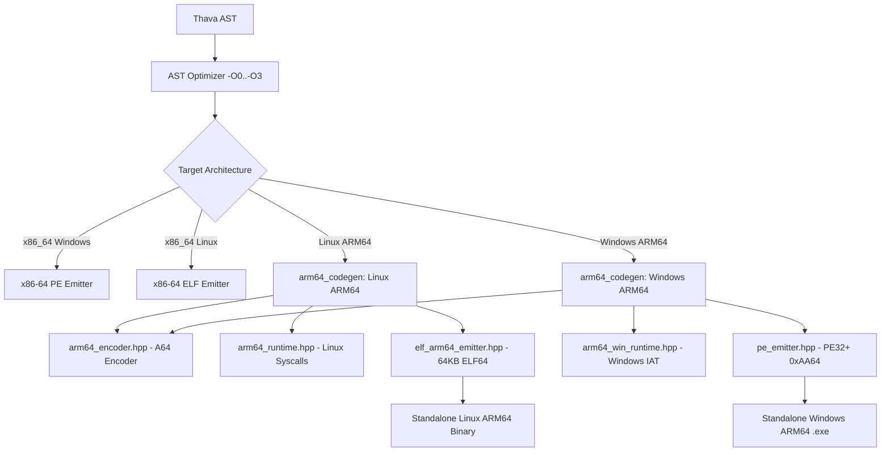

# Thava Programming Language: Official Reference Manual

Welcome to the official language specification and technical documentation for **Thava** (`thavac`).

---

## Table of Contents

1. [Language Overview & Design Principles](#1-language-overview--design-principles)
2. [Source Code Representation & Lexical Structure](#2-source-code-representation--lexical-structure)
3. [Type System](#3-type-system)
   - [Primitive Types](#primitive-types)
   - [Collection Types](#collection-types)
   - [First-Class Function Type (`<func>`)](#first-class-function-type-func)
   - [Special Types](#special-types)
   - [Type Casting](#type-casting)
4. [Expressions & Operators](#4-expressions--operators)
   - [Arithmetic Operators](#arithmetic-operators)
   - [Bitwise Operators](#bitwise-operators)
   - [Logical & Comparison Operators](#logical--comparison-operators)
   - [Ternary Conditional Expression](#ternary-conditional-expression)
   - [String Manipulation & Interpolation](#string-manipulation--interpolation)
5. [Statements & Control Flow](#5-statements--control-flow)
   - [Variable Declarations & Assignments](#variable-declarations--assignments)
   - [Branching (`if`, `elif`, `else`)](#branching-if-elif-else)
   - [Loops (`for`, `range`, `while`)](#loops-for-range-while)
   - [Jump Statements (`break`, `continue`)](#jump-statements-break-continue)
   - [Scoped Context Blocks (`file.open`)](#scoped-context-blocks-fileopen)
   - [Error Raising & Exception Handling (`raise_error`, `throw`, `try`, `except`)](#error-raising--exception-handling-raise_error-throw-try-except)
   - [Deferred Cleanup (`defer`)](#deferred-cleanup-defer)
6. [Functions & Code Generation](#6-functions--code-generation)
   - [Function Declarations & Return Syntax](#function-declarations--return-syntax)
   - [Default Arguments](#default-arguments)
   - [Mutual Recursion & Forward Declarations (`fdfunc`)](#mutual-recursion--forward-declarations-fdfunc)
   - [Inline Functions (`inline func`)](#inline-functions-inline-func)
   - [Function Pointers & Callbacks](#function-pointers--callbacks)
7. [Object-Oriented Programming (OOP) & Structs](#7-object-oriented-programming-oop--structs)
   - [Classes & Single Inheritance](#classes--single-inheritance)
   - [Access Modifiers](#access-modifiers)
   - [Constructors, `locvar`, and `parvar`](#constructors-locvar-and-parvar)
   - [Native Structs](#native-structs)
   - [Enumerations (`enum`)](#enumerations-enum)
8. [Compiler Directives & Foreign Function Interface (FFI)](#8-compiler-directives--foreign-function-interface-ffi)
   - [Modular Inclusions (`@attach`)](#modular-inclusions-attach)
   - [Dynamic Library Linkage (`@dlattach`)](#dynamic-library-linkage-dlattach)
   - [C/C++ Interoperability (`@cattach`, `cfunc`, `c.`)](#cc-interoperability-cattach-cfunc-c)
9. [Standard Libraries Reference](#9-standard-libraries-reference)
   - [`cons` (Console I/O)](#cons-console-io)
   - [`key` (Keyboard Input)](#key-keyboard-input)
   - [`os` (Operating System Services)](#os-operating-system-services)
   - [`time` (Clocks & Dates)](#time-clocks--dates)
   - [`clib` (Dynamic Library Interop & Raw Memory FFI)](#clib-dynamic-library-interop--raw-memory-ffi)
10. [Built-in Collection & String API](#10-built-in-collection--string-api)
    - [String Manipulation (`<str>`)](#string-manipulation-str)
    - [List Operations (`<lst>`)](#list-operations-lst)
    - [Dictionary Operations (`<dict>`)](#dictionary-operations-dict)
11. [File I/O & Scoped Streams (`file.open`)](#11-file-io--scoped-streams-fileopen)
12. [Compiler Architecture & Optimization Pipeline](#12-compiler-architecture--optimization-pipeline)
    - [Compiler Invocation & Flags](#compiler-invocation--flags)
    - [Optimization Levels (`-O0` to `-O3`)](#optimization-levels--o0-to--o3)
    - [Embedded Binary Metadata Format](#embedded-binary-metadata-format)
13. [Target Platforms & ARM64 Roadmap](#13-target-platforms--arm64-roadmap)
    - [Current Supported Platforms](#current-supported-platforms)
    - [AArch64 / ARM64 Backend Architecture & Next Steps](#aarch64--arm64-backend-architecture--next-steps)

---

## 1. Language Overview & Design Principles

**Thava** is a statically typed, compiled systems and application programming language designed to unite the performance and raw memory capabilities of C with the syntactic clarity and rapid development velocity of modern high-level languages.

### Core Architectural Pillars
1. **Self-Contained Direct Code Generation:**
   `thavac` possesses an integrated x86-64 machine code assembler and file format emitter. It generates standalone Windows PE32+ (`.exe`, `.thdl`) and Linux ELF64 binaries directly to disk with **zero toolchain dependencies** (no external linker, assembler, or C runtime library required).
2. **Dual-Backend Resilience:**
   While the direct native backend produces zero-dependency machine code with microsecond build times, Thava also features a transpiler targeting standard C++17. This fallback automatically activates when interfacing with native C++ headers via `@cattach`.
3. **Determinism and Zero-Cost Abstractions:**
   Memory safety is achieved through deterministic scoping rules, RAII context guards (`file.open`), and stack-allocated `defer` tracking rather than garbage collection pause times.

---

## 2. Source Code Representation & Lexical Structure

### Encodings & Files
* Thava source files must be encoded in **UTF-8**.
* Source files use the `.thv` extension.
* Compiled Thava dynamic libraries on Windows use `.thdl` (Thava Dynamic Library) and on Linux use `.so`.

### Comments
```thava
# This is a single-line comment (Python-style)
// This is also a single-line comment (C-style)
/* This is a multi-line comment block */
```

### Identifiers
Identifiers start with an ASCII letter or underscore (`[a-zA-Z_]`) followed by alphanumeric characters or underscores (`[a-zA-Z0-9_]`). Identifiers are case-sensitive (`data` and `Data` are distinct symbols).

---

## 3. Type System

Thava employs explicit, static typing with a clean angle-bracket syntax `<type>` that clearly differentiates type annotations from variable identifiers.

### Primitive Types
| Type | Keyword | Size | Description |
| :--- | :--- | :--- | :--- |
| **Integer** | `<int>` | 64-bit | Signed two's-complement integer (`long long`). |
| **Float** | `<fl>` | 32-bit | Single-precision IEEE 754 floating-point. |
| **Double** | `<dbl>` | 64-bit | Double-precision IEEE 754 floating-point. |
| **Boolean** | `<bl>` | 8-bit / 1-bit | Logical truth value (`true` or `false`). |
| **String** | `<str>` | Dynamic | Heap-allocated UTF-8 character string. |

### Collection Types
| Type | Keyword | Description |
| :--- | :--- | :--- |
| **List** | `<lst>` | Dynamic array of heterogeneous `ThavaValue` elements (`[1, "two", 3.0]`). |
| **Tuple** | `<tple>` | Fixed-size immutable sequence (`(10, 20, "label")`). |
| **Dictionary** | `<dict>` | Associative key-value map (`{"id": 101, "role": "admin"}`). |
| **Multi-Type** | `<multype>` | Generic variant container holding any supported primitive or collection. |

### First-Class Function Type (`<func>`)
Thava treats functions as first-class citizens without the cryptic syntax of C function pointers. The `<func>` type (aliases: `<fn>`, `<callback>`) stores references to functions with arbitrary signatures:
```thava
<int> func multiply(<int> a, <int> b) {
    return a * b
}

# Variable declaration
<func> operation = multiply

# Invocation
<int> result = operation(7, 8) # 56
```

### Special Types
* `<void>`: Indicates that a function returns no value.
* `none`: Represents the absence of a value (`ThavaNoneType`). Equivalent to `None` in Python or `nullptr`.

### Type Casting
Thava provides explicit type casting using either `<target_type>(expr)` or `<target_type> expr`:
```thava
<dbl> precise = 9.99
<int> truncated = <int>(precise) # 9

<int> number = 42
<str> as_string = <str>(number) # "42"
```

---

## 4. Expressions & Operators

### Arithmetic Operators
* `+` : Addition or string concatenation.
* `-` : Subtraction or unary negation.
* `*` : Multiplication, or string repetition (`"abc" * 3` -> `"abcabcabc"`).
* `/` : Floating-point division.
* `//` : Floor (integer) division.
* `%` : Modulo / remainder.
* `**` : Exponentiation (`2 ** 10` -> `1024`).

### Bitwise Operators
* `band` : Bitwise AND (`a band b`).
* `bor`  : Bitwise OR (`a bor b`).
* `bxor` : Bitwise XOR (`a bxor b`).
* `bnot` : Bitwise NOT (`bnot a`).
* `<<`   : Bitwise shift left (`x << 2`).
* `>>`   : Bitwise shift right (`x >> 2`).

### Logical & Comparison Operators
* `and`, `or`, `not` : Boolean logical conjunction, disjunction, and negation.
* `==`, `!=` : Equality and inequality (supports deep equality for collections).
* `<`, `<=`, `>`, `>=` : Relational comparisons.
* `in` : Collection membership test (`if 3 in [1, 2, 3] { ... }`).

### Ternary Conditional Expression
Thava supports Pythonic inline conditional expressions:
```thava
<str> status = "adult" if age >= 18 else "minor"
```

### String Manipulation & Interpolation
Strings support UTF-8-safe methods and string interpolation inside `cons.out`:
```thava
<str> s = "  hello world  "
cons.out(s.strip().title()) # "Hello World" (Method chaining supported)

# String Interpolation using @{...}
<int> score = 95
cons.out("Player score is: @{score} points (@{score + 5} next level)")
```

---

## 5. Statements & Control Flow

### Variable Declarations & Assignments
```thava
<int> x = 100
x += 25
x *= 2
```

### Branching (`if`, `elif`, `else`)
Braces `{}` are mandatory; parentheses around conditions are optional.
```thava
if x > 200 {
    cons.out("Greater than 200")
} elif x == 200 {
    cons.out("Equal to 200")
} else {
    cons.out("Less than 200")
}
```

### Loops (`for`, `range`, `while`)
Thava provides three primary loop constructs:

#### 1. Python-style Range Loop
The step direction (positive or negative) is evaluated dynamically at runtime:
```thava
for <int> i in range(0, 10, 2) {
    cons.out(i) # Prints 0, 2, 4, 6, 8
}
```

#### 2. Foreach Iteration
Iterates over elements in lists, tuples, dictionaries (keys), or strings:
```thava
for <str> item in ["apple", "banana", "cherry"] {
    cons.out(item)
}
```

#### 3. Classic C-style 3-part Loop
```thava
for <int> i = 0, i < 5, i += 1 {
    cons.out(i)
}
```

#### 4. While Loop
```thava
while active {
    # do work
}
```

### Jump Statements (`break`, `continue`)
Supported inside all loop constructs:
```thava
for <int> i in range(1, 100) {
    if i % 2 == 0 { continue }
    if i > 15 { break }
    cons.out(i)
}
```

### Scoped Context Blocks (`file.open`)
Guarantees that files are closed deterministically upon exiting the scope:
```thava
file.open("config.json", "r") as f {
    <str> content = f.read()
    cons.out(content)
} # Closed automatically
```

### Error Raising & Exception Handling (`raise_error`, `throw`, `try`, `except`)

Thava features a dual-layer error management system supporting both **compile-time semantic assertion failures** and **runtime exception handling**.

#### 1. Raising Explicit Errors (`raise_error`)

The `raise_error` construct allows developers to trigger fatal errors either statically during compilation or dynamically during program execution:

```
raise_error(kind, type, message)
```

* **`kind` (Evaluation Mode):**
  * `c` or `compile`: **Compile-Time Error**. Evaluated during the compiler's semantic analysis and static type-checking pass. If reached or evaluated in static code, `thavac` immediately halts compilation with exit code `1` and outputs:
    ```text
    [Compilation Error (type)]: message at line <line_number>
    ```
    This is ideal for static assertion guards, architecture verification, and configuration invariants.
  * `r` or `runtime`: **Runtime Error**. Evaluated at runtime when execution reaches the statement. Both the Native Machine Code backend and the C++ transpiler emit an error message and terminate the process with exit code `1`:
    ```text
    [Runtime Error (type)]: message
    ```

* **`type` (Error Category):** String expression indicating the error type (e.g. `"ValueError"`, `"TypeError"`, `"IndexError"`, `"SecurityError"`).
* **`message` (Error Description):** String expression detailing the failure cause.

##### Code Examples:

```thava
# Example A: Compile-Time Assertion (kind: c)
# Halts thavac immediately during build time
func verify_environment() {
    # If a static rule or check fails:
    raise_error(c, "PlatformError", "Direct hardware access is not permitted on this architecture")
}

# Example B: Runtime Validation (kind: r)
# Halts application execution when triggered
<dbl> func calculate_square_root(<dbl> value) {
    if value < 0.0 {
        raise_error(r, "ValueError", "Cannot compute square root of a negative number")
    }
    # Calculation continues if value >= 0.0
    return c.sqrt(value)
}

func main() {
    <dbl> res = calculate_square_root(-4.0)
    # Output: [Runtime Error (ValueError)]: Cannot compute square root of a negative number
}
```

#### 2. Throwing Exceptions (`throw` / `raise`)

To throw an exception that can be caught by surrounding handler blocks, use `throw` or `raise`:

```thava
func process_file(<str> filepath) {
    if not os.exists(filepath) {
        throw "Target file was not found: " + filepath
    }
}
```

#### 3. Structured Exception Handling (`try`, `except`)

The `try`-`except` block intercepts thrown exceptions and runtime errors:

```thava
try {
    process_file("config.cfg")
} except RuntimeError as e {
    cons.out("Caught runtime error: @{e}")
} except {
    cons.out("Caught generic unhandled exception")
}
```

### Deferred Cleanup (`defer`)
Statements or blocks declared with `defer` execute right before the surrounding function returns or before the application exits in `main`.
* **LIFO (Last-In, First-Out):** Defers execute in reverse declaration order.
* **Return Value Safety:** Expressions returned by `return` are preserved in registers (`RAX`/`XMM0`) and cannot be corrupted by deferred statements.
```thava
<int> func execute_transaction() {
    cons.out("Start transaction")
    defer cons.out("Cleanup 1: End transaction")
    defer {
        cons.out("Cleanup 2: Flush WAL logs")
    }
    return 100
}
# Output:
# Start transaction
# Cleanup 2: Flush WAL logs
# Cleanup 1: End transaction
```

---

## 6. Functions & Code Generation

### Function Declarations & Return Syntax
Functions can specify return types preceding the name or after an arrow `->`:
```thava
# Standard declaration
<int> func compute(<int> a, <int> b) {
    return a + b
}

# Arrow return syntax
func compute_arrow(<int> a, <int> b) -> <int> {
    return a + b
}

# Void function (no return value)
<void> func log_event(<str> msg) {
    cons.out("[LOG]: " + msg)
}
```

### Default Arguments
Trailing parameters can specify default values:
```thava
<int> func power(<int> base, <int> exp = 2) {
    return base ** exp
}
cons.out(power(5))    # 25
cons.out(power(5, 3)) # 125
```

### Mutual Recursion & Forward Declarations (`fdfunc`)
When two or more functions call each other recursively, declare their signatures using `fdfunc`:
```thava
<bl> fdfunc is_even(<int> n)
<bl> fdfunc is_odd(<int> n)

<bl> func is_even(<int> n) {
    if n == 0 { return true }
    return is_odd(n - 1)
}

<bl> func is_odd(<int> n) {
    if n == 0 { return false }
    return is_even(n - 1)
}
```

### Inline Functions (`inline func`)
Prefixing a function with `inline` instructs the Thava AST Optimizer to eliminate function call overhead by copying and folding the function body directly into the call site:
```thava
inline <int> func fast_add(<int> a, <int> b) {
    return a + b
}

<int> sum = fast_add(10, 20) # Replaced with 10 + 20 -> 30 at compile-time!
```

### Function Pointers & Callbacks
Pass functions as arguments to implement event loops, filters, and strategy patterns:
```thava
<int> func filter_and_sum(<lst> items, <func> predicate) {
    <int> total = 0
    for <int> val in items {
        if predicate(val) {
            total += val
        }
    }
    return total
}

<bl> func is_positive(<int> x) {
    return x > 0
}

<int> result = filter_and_sum([-5, 10, -2, 20], is_positive) # 30
```

---

## 7. Object-Oriented Programming (OOP) & Structs

### Classes & Single Inheritance
Classes support single inheritance with encapsulation and polymorphism:
```thava
class Vehicle {
    <str> brand;
    <int> speed;

    func Vehicle(<str> brand, <int> speed) {
        locvar.brand = brand
        locvar.speed = speed
    }

    <void> func describe() {
        cons.out("Vehicle: " + locvar.brand + " @ " + <str>(locvar.speed) + " km/h")
    }
}

class Car : Vehicle {
    <int> doors;

    func Car(<str> brand, <int> speed, <int> doors) {
        parvar.init(brand, speed)
        locvar.doors = doors
    }

    <void> func describe() {
        cons.out("Car: " + locvar.brand + " (" + <str>(locvar.doors) + " doors)")
    }
}
```

### Access Modifiers
* `public`: Accessible from anywhere (default).
* `protected`: Accessible within the declaring class and derived subclasses.
* `private`: Accessible strictly within the declaring class.

### Native Structs
Structs represent lightweight, contiguous memory layouts:
```thava
struct Vector3 {
    <dbl> x;
    <dbl> y;
    <dbl> z;
}

Vector3 v = Vector3(1.0, 2.5, 0.0)
v.z = 10.0
```

### Enumerations (`enum`)
```thava
enum HttpStatus {
    OK = 200,
    NOT_FOUND = 404,
    SERVER_ERROR = 500
}

<int> code = HttpStatus.NOT_FOUND
```

---

## 8. Compiler Directives & Foreign Function Interface (FFI)

### Modular Inclusions (`@attach`)
Thava provides safe module attachment. Circular inclusions are guarded automatically:
```thava
@attach <math_utils.thv>
@attach "engine/renderer.thv"
```

### Dynamic Library Linkage (`@dlattach`)
When loading a Thava dynamic library (`.thdl` or `.so`), the compiler reads embedded export metadata directly from the binary:
```thava
@dlattach <math_lib.thdl>
# Functions declared in math_lib are now available with full static typing!
```

### C/C++ Interoperability (`@cattach`, `cfunc`, `c.`)
To call external C libraries or C++ headers, attach the header and declare signatures with `cfunc`:
```thava
@cattach <math.h>

<dbl> cfunc sin(<dbl> rad)
<dbl> cfunc cos(<dbl> rad)

<dbl> val = c.sin(1.57) # Explicit C namespace invocation
```

---

## 9. Standard Libraries Reference

Thava comes equipped with built-in standard modules that provide essential runtime and operating system capabilities.

### `cons` (Console I/O)
* `cons.out(arg1, arg2, ...)`: Formats and writes expressions separated by spaces, terminated with a newline to standard output. Supports string interpolation using `@{expression}` syntax.

```thava
<str> name = "World"
<int> count = 42
cons.out("Hello", name, "Count:", count)
cons.out("Interpolated: @{name} has @{count * 2} items")
```

### `key` (Keyboard Input)
* `key.input(<type>, prompt)`: Displays `prompt` to standard output and reads input from standard input, parsing it into the requested type `<int>`, `<fl>`, `<dbl>`, `<bl>`, or `<str>`.
* `key.input.upper(<str>, prompt)`: Reads a line of input and converts all characters to uppercase.
* `key.input.lower(<str>, prompt)`: Reads a line of input and converts all characters to lowercase.

```thava
<int> age = key.input(<int>, "Enter your age: ")
<str> command = key.input.lower(<str>, "Action [run/stop]: ")
```

### `os` (Operating System Services)
Provides high-performance platform utilities:
* `os.system(<str> cmd) -> <int>`: Executes a command string in the host system shell and returns the exit status code.
* `os.getcwd() -> <str>`: Returns the current working directory path.
* `os.chdir(<str> path) -> <bl>`: Changes the current working directory.
* `os.exists(<str> path) -> <bl>`: Returns `true` if a file or directory exists at `path`.
* `os.is_file(<str> path) -> <bl>`: Returns `true` if `path` is a regular file.
* `os.is_dir(<str> path) -> <bl>`: Returns `true` if `path` is a directory.
* `os.getsize(<str> path) -> <int>`: Returns file size in bytes (-1 on failure).
* `os.listdir(<str> path) -> <lst>`: Returns a list of filenames contained in directory `path`.
* `os.mkdir(<str> path) -> <bl>`: Creates a directory.
* `os.rmdir(<str> path) -> <bl>`: Removes an empty directory.
* `os.remove(<str> path) -> <bl>`: Deletes a file from the filesystem.
* `os.rename(<str> old_path, <str> new_path) -> <bl>`: Renames or moves a file.
* `os.getenv(<str> var_name) -> <str>`: Retrieves the value of an environment variable.
* `os.setenv(<str> var_name, <str> val) -> <bl>`: Sets or updates an environment variable.
* `os.getpid() -> <int>`: Returns the unique process ID of the current running process.
* `os.cpu_count() -> <int>`: Returns the number of logical CPU cores available.
* `os.sleep(<int> milliseconds)`: Suspends execution for the specified time interval.
* `os.showmessagebox(<int> icon, <str> title, <str> content, <int> buttons)`: Displays a native operating system message dialog.

### `time` (Clocks & Dates)
* `time.timestamp() -> <int>`: Returns the current Unix epoch time in seconds.
* `time.millis() -> <int>`: Returns high-resolution epoch time in milliseconds.
* `time.now(<str> format) -> <str>`: Returns the current time formatted according to the specifier string (e.g., `"YYYY-MM-DD HH:mm:ss"`).
* `time.date() -> <str>`: Returns date in standard `"YYYY-MM-DD"` format.
* `time.year() -> <int>`: Current 4-digit calendar year (e.g. `2026`).
* `time.month() -> <int>`: Current month (`1` - `12`).
* `time.day() -> <int>`: Current day of month (`1` - `31`).
* `time.hour() -> <int>`: Current hour in 24-hour format (`0` - `23`).
* `time.minute() -> <int>`: Current minute (`0` - `59`).
* `time.second() -> <int>`: Current second (`0` - `59`).

### `clib` (Dynamic Library Interop & Raw Memory FFI)
The `clib` library allows calling arbitrary shared libraries (`.dll` on Windows, `.so` on Linux) and accessing physical memory addresses:
* `clib.load(<str> path) -> <int>`: Loads a dynamic shared library into the address space and returns an opaque library handle.
* `clib.free(<int> handle) -> <bl>`: Unloads the library from memory.
* `clib.has(<int> handle, <str> symbol) -> <bl>`: Checks if an exported function symbol exists in the library.
* `clib.call(<int> handle, <str> symbol, args...) -> <int>`: Calls an exported C-ABI function returning a 64-bit integer.
* `clib.call_dbl(<int> handle, <str> symbol, args...) -> <dbl>`: Calls an exported function returning a 64-bit double precision float.
* `clib.call_str(<int> handle, <str> symbol, args...) -> <str>`: Calls an exported function returning a null-terminated `const char*`.
* `clib.alloc(<int> bytes) -> <int>`: Allocates a contiguous heap block and returns its 64-bit memory pointer.
* `clib.free_mem(<int> ptr) -> <void>`: Deallocates a heap block allocated via `clib.alloc`.
* `clib.peek_u8(<int> ptr, <int> offset) -> <int>`: Reads an 8-bit unsigned byte.
* `clib.peek32(<int> ptr, <int> offset) -> <int>`: Reads a 32-bit signed integer.
* `clib.peek64(<int> ptr, <int> offset) -> <int>`: Reads a 64-bit signed integer.
* `clib.peek_f(<int> ptr, <int> offset) -> <dbl>`: Reads a 64-bit floating-point number.
* `clib.poke32(<int> ptr, <int> offset, <int> val) -> <void>`: Writes a 32-bit integer into memory.
* `clib.poke64(<int> ptr, <int> offset, <int> val) -> <void>`: Writes a 64-bit integer into memory.
* `clib.poke_f(<int> ptr, <int> offset, <dbl> val) -> <void>`: Writes a 64-bit float into memory.

---

## 10. Built-in Collection & String API

Thava variables of string and collection types feature built-in methods with seamless dot-notation syntax:

### String Manipulation (`<str>`)
* `s.len() -> <int>`: Returns character count.
* `s.upper() -> <str>`: Returns an uppercase copy.
* `s.lower() -> <str>`: Returns a lowercase copy.
* `s.strip() -> <str>`: Trims leading and trailing whitespace.
* `s.title() -> <str>`: Capitalizes the first letter of each word.
* `s.find(<str> substr) -> <int>`: Returns the 0-based index of the first occurrence of `substr` (-1 if not found).
* `s.count(<str> substr) -> <int>`: Counts non-overlapping occurrences of `substr`.
* `s.replace(<str> old_str, <str> new_str) -> <str>`: Replaces all occurrences of `old_str` with `new_str`.
* `s.split(<str> delimiter) -> <lst>`: Splits string into a list of substrings.
* `s.startswith(<str> prefix) -> <bl>`: Returns `true` if string starts with `prefix`.
* `s.endswith(<str> suffix) -> <bl>`: Returns `true` if string ends with `suffix`.

### List Operations (`<lst>`)
* `lst.len() -> <int>`: Returns element count.
* `lst.append(<multype> val)` / `lst.addval(<multype> val)`: Appends an item to the end of the list.
* `lst.insert(<int> index, <multype> val)`: Inserts an item at the specified position.
* `lst.remove(<multype> val)` / `lst.removeval(<multype> val)`: Removes the first occurrence of `val`.
* `lst.pop(<int> index = -1) -> <multype>`: Removes and returns the item at `index` (defaults to last element).
* `lst.index(<multype> val) -> <int>`: Returns index of first match (-1 if absent).
* `lst.count(<multype> val) -> <int>`: Counts occurrences of `val`.
* `lst.clear()`: Empties the list.

### Dictionary Operations (`<dict>`)
* `d.len() -> <int>`: Returns number of key-value pairs.
* `d.keys() -> <lst>`: Returns a list containing all keys.
* `d.values() -> <lst>`: Returns a list containing all values.
* `d.items() -> <lst>`: Returns a list of key-value tuples.
* `d.get(<str> key, <multype> default_val = none) -> <multype>`: Retrieves value or returns default.
* `d.contains(<str> key) -> <bl>`: Checks if `key` exists in dictionary.
* `d.del(<str> key)`: Deletes key and its associated value.
* `d.clear()`: Empties all entries from the dictionary.

---

## 11. File I/O & Scoped Streams (`file.open`)

Thava handles file input/output through RAII-guarded context blocks (`file.open ... as <handle>`). The stream automatically flushes buffers and closes upon exiting the block, even if an unhandled exception or early `return` occurs inside:

### Supported Open Modes
| Mode | Description |
| :--- | :--- |
| `"r"` | Read text (default). File must exist. |
| `"w"` | Write text. Overwrites existing file or creates new file. |
| `"a"` | Append text. Writes to the end of the file. |
| `"rb"` | Read binary stream. |
| `"wb"` | Write binary stream. |

### Stream Methods
* `f.read() -> <str>`: Reads the entire file content into a string.
* `f.readline() -> <str>` / `f.read_line()`: Reads a single line including newline.
* `f.readlines() -> <lst>` / `f.read_lines()`: Reads all lines and returns a list of strings.
* `f.write(<str> text)`: Writes string to the stream.
* `f.writeline(<str> text)`: Writes string followed by a newline character.

```thava
# Writing to a file
file.open("output.txt", "w") as f {
    f.writeline("Thava File I/O Engine")
    f.writeline("Deterministic Scoping Demonstration")
}

# Reading lines from a file
file.open("output.txt", "r") as f {
    for <str> line in f.readlines() {
        cons.out("Read line:", line.strip())
    }
} # Stream is closed deterministically here
```

---

## 12. Compiler Architecture & Optimization Pipeline

### Compiler Invocation & Flags
```text
Usage: thavac <source.thv> [-o <output_binary>] [--arch x86_64|arm64] [--backend native|elf|pe|arm64|cpp] [--lib] [-O0|-O1|-O2|-O3]
       thavac --info <file.thdl|.so>
```

| Flag | Description |
| :--- | :--- |
| `-o <filename>` | Specify output executable or dynamic library name. |
| `--arch arm64` | Target Linux AArch64 / ARM64 architecture (Zero-dependency direct ELF64 emitter). |
| `--arch x86_64` | Target x86-64 architecture (Default). |
| `--backend native` | Direct Native machine code generation for host OS (Default). |
| `--backend arm64` / `--backend elf-arm64` | Direct Native Linux AArch64 (ARM64) ELF64 code generation. |
| `--backend pe-arm64` / `--target win-arm64` | Direct Native Windows ARM64 (PE32+ `0xAA64`) code generation [Experimental]. |
| `--backend elf` | Direct Native Linux x86-64 ELF64 binary. |
| `--backend pe` | Direct Native Windows x86-64 PE32+ binary. |
| `--backend cpp` | Transpile to optimized C++17 and build via host C++ compiler. |
| `--backend cpp-arm64` | Transpile to C++17 and cross-compile via `aarch64-linux-gnu-g++`. |
| `--lib` | Build as a Dynamic Library (`.thdl` on Windows, `.so` on Linux). |
| `-O0` to `-O3` | AST Optimization levels (Dead Code Elimination, Inlining, Constant Folding). |
| `--info <file>` | Inspect embedded metadata of a Thava Dynamic Library (`.thdl` / `.so`). |

### Optimization Levels (`-O0` to `-O3`)
* **`-O0` (No Optimizations):** Fast debug builds. Generates direct stack frame instructions for every statement.
* **`-O1` (Peephole & Constant Folding):** Folds compile-time arithmetic (`2 + 3 * 4` -> `14`), algebraic identities (`x + 0`, `x * 1`, `x * 0`), and constant boolean conditions.
* **`-O2` (AST Inlining & Dead Code Elimination):** Expands `inline func` declarations directly into call sites, prunes dead conditional branches, and optimizes variable copies.
* **`-O3` (Instruction Scheduling & Memory-Direct Arithmetic):** Replaces memory loads and stores with single compound instructions and maximizes register utilization.

### Embedded Binary Metadata Format
When generating dynamic libraries (`--lib`), `thavac` embeds an internal metadata section bounded by `__THAVA_METADATA_START__` and `__THAVA_METADATA_END__`. When another Thava program links against the library using `@dlattach`, the compiler automatically discovers and types every exported symbol without requiring separate header files or `.meta` companion files.

---

## 13. Target Platforms & ARM64 Architecture

### Supported Target Platforms
1. **Windows x86-64 (Active):**
   - Emits standalone PE32+ `.exe` executables and `.thdl` dynamic libraries.
   - Zero-dependency assembler directly writes DOS stub, PE headers, COFF sections (`.text`, `.rdata`, `.data`, `.pdata`, `.xdata`), and import/export directory tables.
2. **Linux x86-64 (Active):**
   - Emits standalone ELF64 executables and `.so` shared objects.
   - Program headers, dynamic symbols, PLT/GOT tables, and GNU hash tables are emitted directly.
3. **Linux AArch64 / ARM64 (Active):**
   - Emits standalone ELF64 executables for 64-bit ARM architecture (`EM_AARCH64` = 183 / 0xB7).
   - Generates pure 32-bit fixed-width A64 instructions with zero external assembler or linker dependencies.
   - Universal 64KB page alignment (`PAGE_ALIGN = 0x10000`) for seamless execution across all standard Linux distributions, Android kernels, and macOS/Apple Silicon VMs.
4. **Windows ARM64 (Active / Experimental):**
   - Emits standalone PE32+ `.exe` executables with `IMAGE_FILE_MACHINE_ARM64` (`0xAA64`) for Windows on ARM (Snapdragon X Elite, Surface Pro ARM).
   - Resolves IAT thunk slots via relative `ADR` + `LDR` + `BLR` to invoke standard Windows C runtime functions (`msvcrt.dll` `printf`, `exit`).
   - AAPCS64 Win64 compliant frame layouts and stack discipline.
5. **C++17 Transpiler Fallback (Active):**
   - Automatic fallback when complex native C++ template headers are attached via `@cattach`.

### AArch64 / ARM64 Backend Architecture
The ARM64 backend operates completely without external toolchains:



#### Key Architectural Implementations for ARM64:
1. **Instruction Encoding (`arm64_encoder.hpp`):**
   - Full 32-bit fixed-width A64 instruction encoder.
   - Arithmetic & Logic: `ADD`, `SUB`, `MUL`, `SDIV`, `UDIV`, `AND`, `ORR`, `EOR`, `MOVZ`, `MOVK`, `MOVN`, `CMP`, `CSET`.
   - Memory Access: Unscaled signed 9-bit load/store (`LDUR`, `STUR`), unsigned scaled 12-bit load/store (`LDR`, `STR`), load/store pair (`LDP`, `STP`), byte access (`LDRB`, `STRB`).
   - Branching & Control: Unconditional branch (`B`), branch with link (`BL`), conditional branch (`B.cond`), compare and branch on zero / non-zero (`CBZ`, `CBNZ`), register indirect branch / call (`BR`, `BLR`), function return (`RET`), supervisor call (`SVC #0`).
   - Relative Addressing: `ADR` with forward/backward label fixup resolution.
2. **AAPCS64 Calling Convention & Stack Discipline:**
   - Parameter passing: registers `X0` through `X7` for integer/pointer parameters and return values.
   - Canonical Frame Layout:
     - Prologue: `stp x29, x30, [sp, #-16]! ; mov x29, sp ; sub sp, sp, #512`.
     - Epilogue: `mov sp, x29 ; ldp x29, x30, [sp], #16 ; ret`.
   - Guaranteed separation between local variables (`[FP - 8]` .. `[FP - 512]`) and temporary stack pushes below `SP`.
3. **Direct Linux Syscall Runtime (`arm64_runtime.hpp`):**
   - Pure, zero-libc runtime using direct kernel syscalls (`SVC #0`):
     - `sys_write` (syscall 64) for stdout console output.
     - `sys_exit` (syscall 93) for clean process termination.
   - Built-in formatting routines: `strlen`, `print_str`, `print_int` (handles arbitrary 64-bit signed integers and negative values), `print_bool`, `print_nl`.
4. **Testing ARM64 on x86-64 without Physical ARM Hardware:**
   - Developers can build on Windows or Linux x86-64 and execute bit-accurately via `qemu-aarch64`:
     ```powershell
     # Compile directly on Windows
     .\thavac.exe my_program.thv --arch arm64 -o my_program
     # Execute inside WSL via user-space emulation
     wsl qemu-aarch64 ./my_program
     ```

